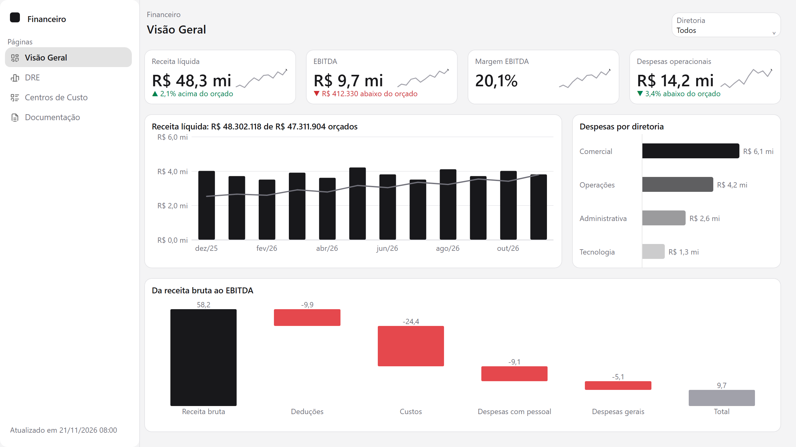
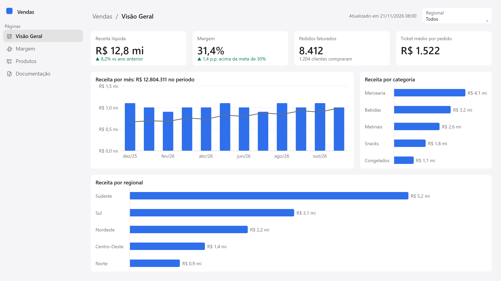
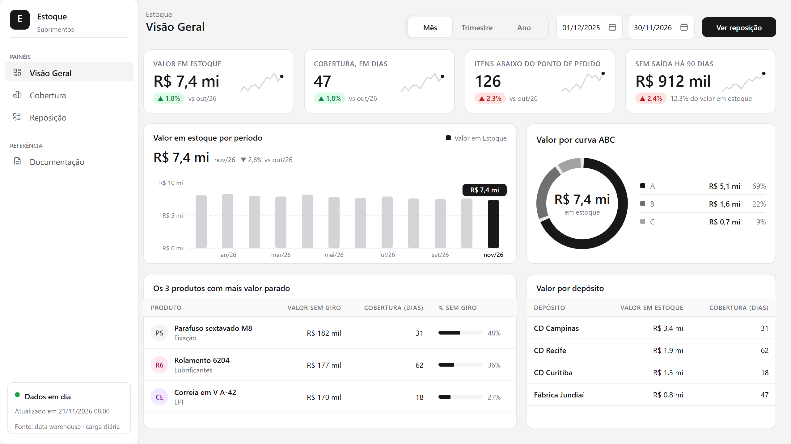
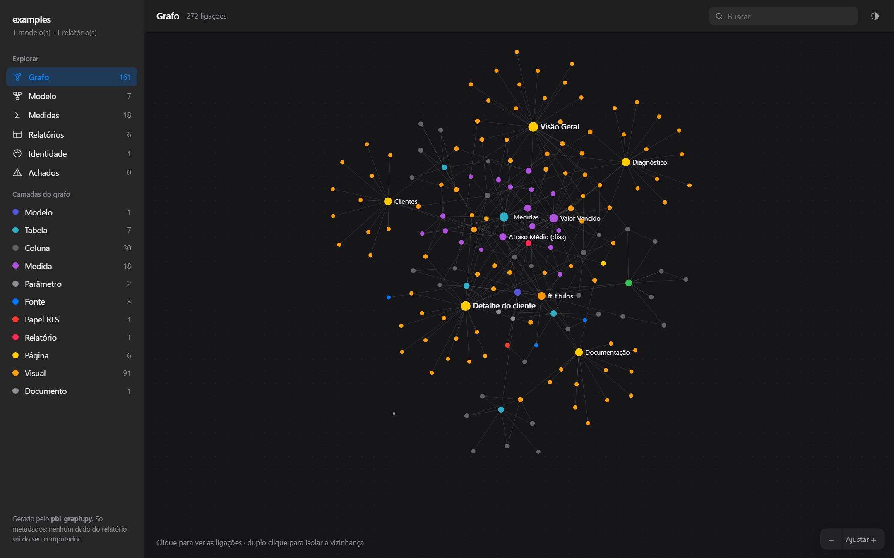
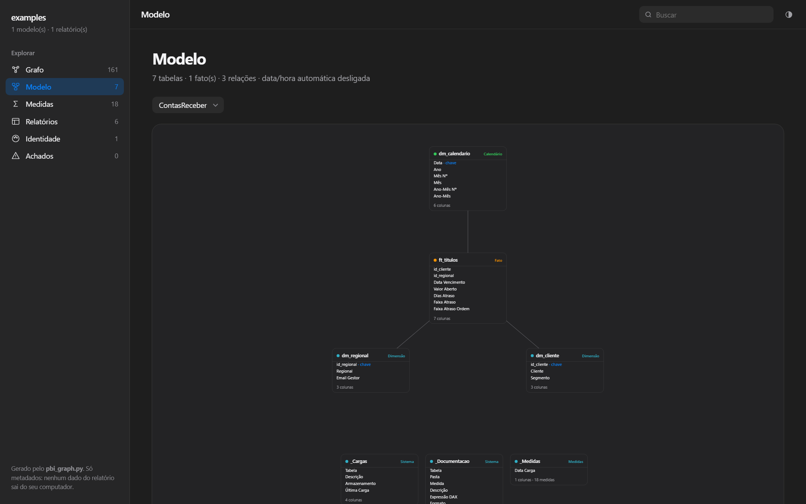
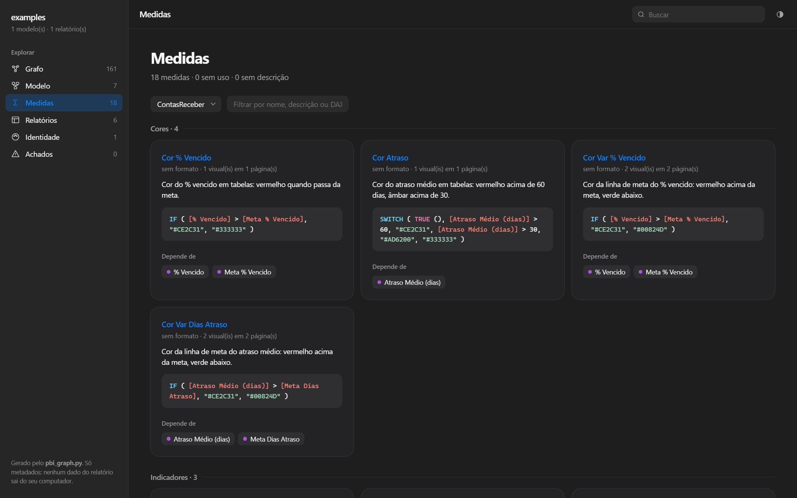
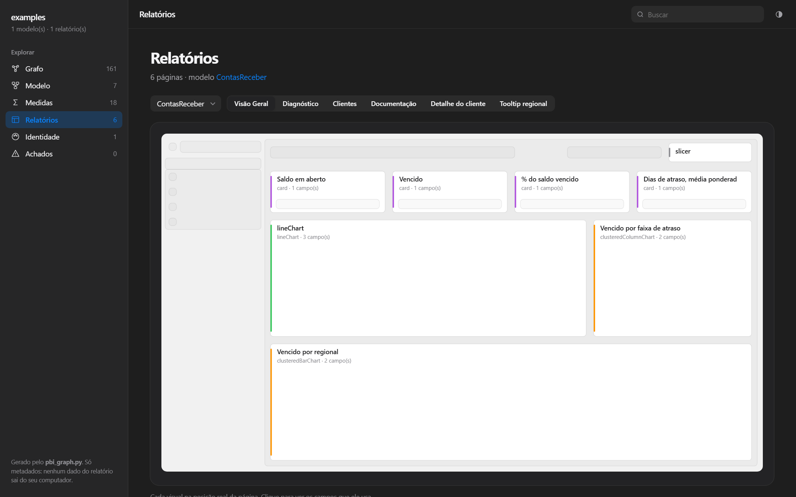

<div align="center">

<picture>
  <source media="(prefers-color-scheme: dark)" srcset="docs/assets/hero-dark.svg">
  
</picture>

[](https://github.com/DaviMark/powerbi-architect/actions/workflows/ci.yml)


**[Instalar](#instale-em-um-minuto)** · **[Benchmark](https://davimark.github.io/powerbi-architect/)** · **[Guia completo](docs/guia.md)** · **[English](README.en.md)**

</div>

<br>

Sua IA já sabe escrever DAX. Esta skill ensina o resto: perguntar antes de construir, desenhar um
modelo estrela enxuto, deixar o Power Query com uma etapa, documentar cada medida e montar páginas que
respondem uma pergunta em três segundos.

<table>
<tr>
<td align="center" width="33%"><h1>100%</h1>dos requisitos cumpridos<br>com a skill</td>
<td align="center" width="33%"><h1>29%</h1>pela mesma IA<br>sem a skill</td>
<td align="center" width="33%"><h1>98</h1>de harmonia média<br>nas páginas, contra 5</td>
</tr>
</table>

<sub>Benchmark da versão 1.5.0: Claude Sonnet 5.5, os mesmos pedidos com e sem a skill, sete requisitos
conferidos por ferramenta. <a href="https://davimark.github.io/powerbi-architect/">Veja a página completa</a>.</sub>

<br>

## Relatórios que parecem produto

Sidebar discreta, um painel branco, uma cor de destaque, números formatados, a meta sempre visível. A IA
descreve as páginas em linhas de visuais e o motor de layout calcula cada pixel na grade de 4 px.



<table>
<tr>
<td width="50%"></td>
<td width="50%"></td>
</tr>
</table>

Antes de entregar, a IA confere o próprio trabalho:

- **Preview sem o Power BI Desktop.** Cada página desenhada no navegador, com eixos, rótulos e os
  números no formato do seu modelo.
- **Crítica pixel a pixel.** Texto cortado, sobreposição, gutters irregulares, tabela que não cabe,
  cartão com sobra.
- **Auditoria com nota.** 65 regras, do modelo ao DAX e ao SQL, e uma nota de harmonia de 0 a
  100 por página. Só entrega com 90 ou mais.

## Explore o seu projeto

Um comando transforma o repositório num mapa navegável: o grafo de tudo o que está ligado, o modelo
estrela, o catálogo de medidas com DAX e cada página do relatório em escala. Uma página só, offline.

```bash
python .claude/skills/powerbi-architect/scripts/pbi_graph.py view
```



<table>
<tr>
<td width="33%"><br><sub><b>Modelo.</b> Fatos, dimensões, chaves e cardinalidade.</sub></td>
<td width="33%"><br><sub><b>Medidas.</b> Descrição, formato, DAX e onde cada uma aparece.</sub></td>
<td width="33%"><br><sub><b>Relatórios.</b> Cada visual na posição real.</sub></td>
</tr>
</table>

O mesmo grafo economiza contexto: a IA lê um resumo de uma página em vez de dezenas de arquivos TMDL e
PBIR. No projeto de exemplo, são 19 vezes menos tokens.

## Instale em um minuto

**Claude Code**

```text
/plugin install powerbi-architect --marketplace DaviMark/powerbi-architect
```

**Qualquer IA no seu repositório** (Claude Code, GitHub Copilot, Cursor, Codex, Gemini CLI)

```bash
git clone -c core.longpaths=true https://github.com/DaviMark/powerbi-architect.git
./powerbi-architect/install/install.sh /caminho/do/repo          # macOS e Linux
.\powerbi-architect\install\install.ps1 -Target C:\caminho\do\repo  # Windows
```

No Windows, o `core.longpaths=true` evita erro de caminho longo nas entregas do benchmark quando a pasta
do clone já é funda.

**Sem terminal** (Claude.ai): baixe o `.zip` da [última versão](https://github.com/DaviMark/powerbi-architect/releases/latest).

Depois, é só pedir trabalho de Power BI. A skill carrega sozinha. Funciona dentro do
[Power BI Workspaces](https://github.com/DaviMark/powerbi-workspaces).

## O que muda na prática

| Você pede um dashboard de contas a receber | IA sem a skill | Com Power BI Architect |
|---|---|---|
| Primeira resposta | já começa a gerar visuais | até cinco perguntas que mudam o modelo |
| Modelo | importa a view inteira | estrela com grão declarado e só as colunas usadas |
| Power Query | renomeia, filtra, muda tipos | uma etapa: SQL nativo, com parâmetros |
| DAX | medidas soltas | descrição, formato e pasta em todas; `DIVIDE` sempre |
| Relatório | 15 visuais, pizza, legenda | título que conclui, KPIs, tendência com a meta, detalhe |
| Entrega | "pronto!" | aprovação humana, números conferidos, página de documentação |

Números, imagens e o custo de cada lado no **[comparativo com e sem a skill](docs/comparativo.md)**.

## Tudo o que vem junto

| | |
|---|---|
| **Kits iniciais** | vendas, financeiro, RH e estoque: projeto PBIP completo, nota 100 na auditoria |
| **Reestilizar** | lê um relatório existente e o refaz no padrão, sem perder informação |
| **Suas edições ficam** | o que você muda no Desktop é percebido e preservado a cada nova geração |
| **Números provados** | `reconcile.py` compara o relatório com a origem, linha a linha |
| **Visual customizado** | só quando nenhum nativo serve, com um `.pbiviz` de referência que compila |
| **Segurança** | só texto e Python legível, sem rede, sem dados no repositório |

Detalhes de cada recurso no **[guia completo](docs/guia.md)**.

## Medido a cada versão

Cada versão nova passa pelo mesmo [benchmark](benchmarks/README.md) e pelas
[avaliações](evals/README.md), com as respostas brutas publicadas, inclusive o que não saiu a favor da
skill. O CI roda os testes no Linux e no Windows, do Python 3.9 ao 3.13, valida os JSON nos schemas da
Microsoft e reconstrói o `.pbiviz` com as ferramentas oficiais.

## Contribua

Padrões de DAX, conectores, arquétipos de página, traduções e avaliações são bem-vindos. Leia o
[CONTRIBUTING.md](CONTRIBUTING.md) e abra uma [issue](https://github.com/DaviMark/powerbi-architect/issues/new/choose).
Se a skill te ajudou, uma estrela no repositório ajuda outras pessoas a encontrá-la.

<sub>MIT © colaboradores do Power BI Architect · Power BI é marca da Microsoft; projeto independente.
[Segurança](SECURITY.md) · [Mudanças](CHANGELOG.md) · [Próximos passos](ROADMAP.md)</sub>
