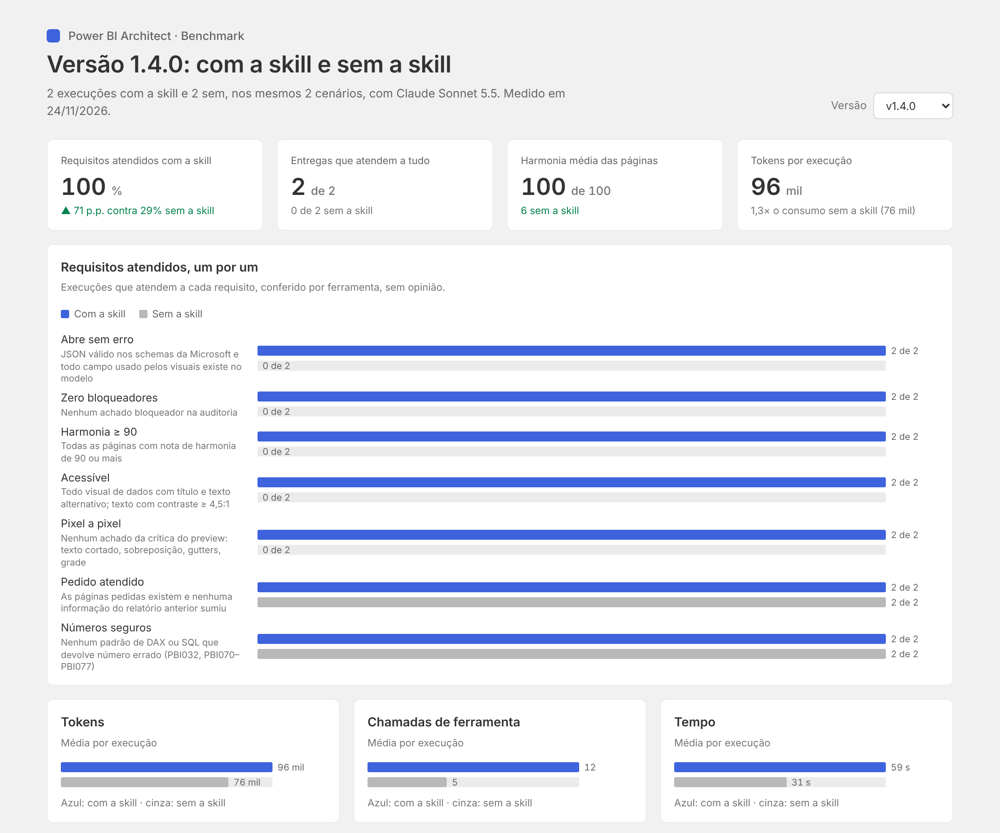

# Benchmark: a skill em cada versão contra a IA sem a skill

Toda versão nova da skill passa pelo mesmo teste. A mesma IA recebe os mesmos dois pedidos duas vezes:
uma com a skill daquela versão e outra sem skill nenhuma. São 4 execuções por versão, poucos minutos ao
todo. As entregas são conferidas pelos mesmos requisitos, sempre por ferramenta. Assim:
- **na versão X**, a comparação é a skill X contra a IA sem a skill;
- **na versão Y**, a comparação é a skill Y contra a IA sem a skill;
- **entre versões**, a página mostra quanto cada versão melhorou (ou piorou) nos mesmos critérios.

**Veja a página publicada: <https://davimark.github.io/powerbi-architect/>**



## Resultados por versão

Claude Sonnet 5.5 nas duas condições, 2 execuções com a skill e 2 sem em cada versão:

| Versão | Com a skill | Sem a skill | Ganho da skill | Contra a versão anterior | Entregas completas com a skill | Tokens com a skill |
|---|---|---|---|---|---|---|
| [1.3.0](results/1.3.0/README.md) | 93% (13 de 14) | 43% (6 de 14) | +50 p.p. | primeira medição | 1 de 2 | 92 mil |
| [1.4.0](results/1.4.0/README.md) | **100% (14 de 14)** | 29% (4 de 14) | **+71 p.p.** | **+7 p.p.** | **2 de 2** | 96 mil |

A 1.4.0 fecha o único requisito que a 1.3.0 deixava aberto: a tabela de clientes da reestilização
mostrava 14 linhas num espaço para 5. Agora a IA com a skill limita a tabela aos 5 maiores com o filtro
Top N do Power BI, diz isso no título e leva a lista completa para uma página própria. Com a skill, a IA
gasta cerca de 1,3 vez mais tokens que sem ela, porque audita e corrige o próprio trabalho. Sem a skill,
as entregas da 1.4.0 nem abririam no Power BI Desktop (erros de schema). Uma versão é sempre comparada
com a IA sem a skill da mesma rodada, e as duas versões foram pontuadas com as mesmas conferências.

A primeira medição da 1.4.0 deu 12 de 14 com a skill: a IA montou dados de amostra com poucos clientes
e, em outra execução, descartou um achado da crítica como "só a amostra". O `SKILL.md` passou a proibir
as duas coisas, o motor de layout passou a avisar sobre tabelas sem `top`, e as 4 execuções da 1.4.0
rodaram de novo. Os números acima são dessa segunda rodada.

**Abra [`index.html`](index.html)** para ver os números e as imagens. Os dados de cada versão ficam em
[`results/<versão>/`](results), com um resumo em Markdown, o `resultados.json`, o `consumo.json` e as
imagens das páginas entregues.

## Os dois cenários

| Cenário | O que a IA recebe | O que se pede |
|---|---|---|
| [Logística](scenarios/s1-logistica.json) | modelo de entregas que a skill não traz, sem relatório | visão geral para a diretoria e comparação de transportadoras |
| [Reestilizar](scenarios/s2-reestilizar.json) | relatório amador (título gigante, pizza, sem texto alternativo) | deixá-lo profissional sem perder informação |

Os dois cobrem as situações mais diferentes: criar do zero e consertar o que já existe. Cada cenário roda
uma vez com a skill e uma vez sem, e a ordem entre as condições alterna de um cenário para o outro.

## Os sete requisitos

| Requisito | Conferido por |
|---|---|
| Abre sem erro | JSON válido nos schemas da Microsoft e todo campo usado pelos visuais existe no modelo |
| Zero bloqueadores | `audit_pbip.py` |
| Harmonia ≥ 90 | `audit_pbip.py`, nota por página |
| Acessível | `audit_pbip.py`: título e texto alternativo em todo visual de dados, contraste do texto |
| Pixel a pixel | `preview_pbir.py --critique`: texto cortado, sobreposição, gutters, grade de colunas |
| Pedido atendido | as páginas pedidas existem; na reestilização, nenhum campo mostrado antes sumiu |
| Números seguros | `audit_pbip.py`: nenhum padrão de DAX ou SQL que devolve número errado (`PBI032`, `PBI070`–`PBI077`) |

Além dos requisitos, cada execução registra o **consumo**: tokens, chamadas de ferramenta e tempo,
como o agente informa ao terminar. O resumo traz a média por condição.

## Como medir uma versão nova

```bash
python benchmarks/run.py prepare
```

O comando cria as 4 pastas em `.tmp/benchmark/<versão>/` e o arquivo `runs.json` com o pedido de cada
execução. Rode cada pedido num agente novo, com o mesmo modelo nas duas condições:
- **Claude Code:** `claude -p "<pedido>" --output-format json`, de dentro da pasta da execução. O JSON de
  saída traz tokens e duração.
- **Subagentes**, como na primeira medição.

Registre o consumo de cada execução:

```bash
python benchmarks/run.py record s1-logistica-com --tokens 95105 --tools 10 --seconds 48 --model "Claude Sonnet 5.5"
```

Depois, confira os requisitos e gere as imagens:

```bash
python benchmarks/run.py score
```

Por fim, atualize a página com todas as versões medidas:

```bash
python benchmarks/run.py report
```

A versão vem do `SKILL.md`. Mude-a antes de medir, para não sobrescrever a anterior.

**Mesma régua para todas as versões.** Se a nova versão muda uma conferência (a auditoria ou a crítica do
preview), confira de novo as entregas guardadas das versões anteriores antes do `report`. As execuções
não rodam de novo; só a pontuação é refeita:

```bash
python benchmarks/run.py score --versao 1.3.0
```

## Limites

- Dois cenários e uma execução por cenário e condição, para medir rápido. Diferenças pequenas podem ser
  acaso; o histórico de versões mostra a tendência.
- Os relatórios não são abertos no Power BI Desktop. As imagens vêm do preview da skill, que é uma
  aproximação.
- Todas as entregas são desenhadas com os mesmos dados de amostra. Uma medida criada pela IA que não está
  na amostra aparece no preview com o próprio nome no lugar do valor.
- A nota de harmonia e a crítica pixel a pixel são regras da própria skill, que a IA sem a skill não
  conhece. Por isso, há também requisitos gerais: abrir sem erro, acessibilidade e pedido atendido.
