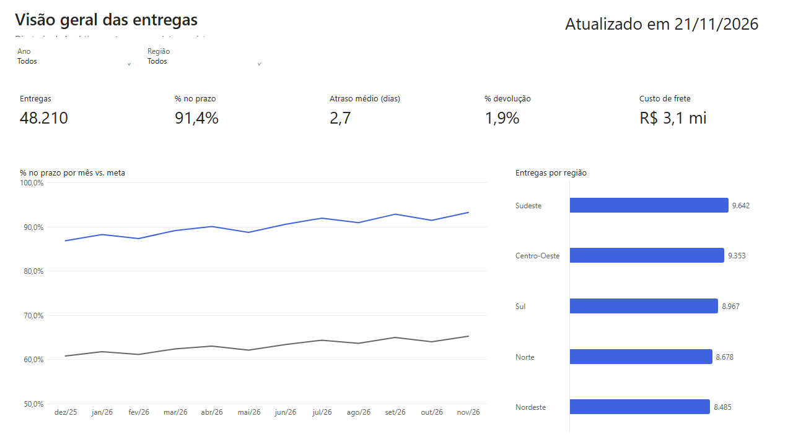
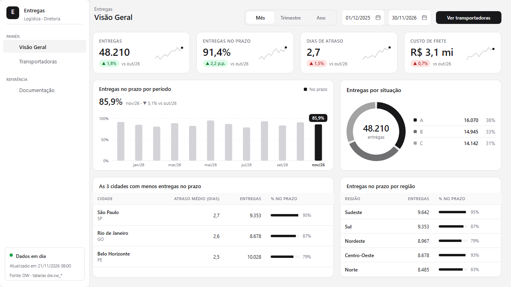
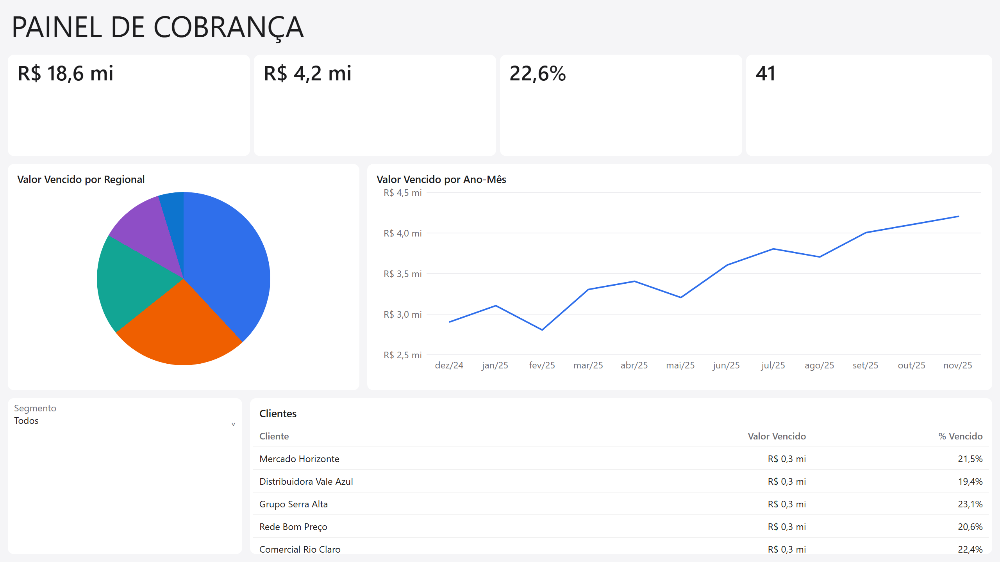
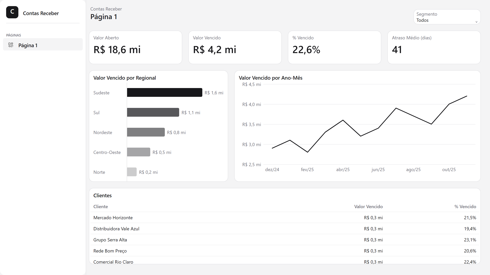
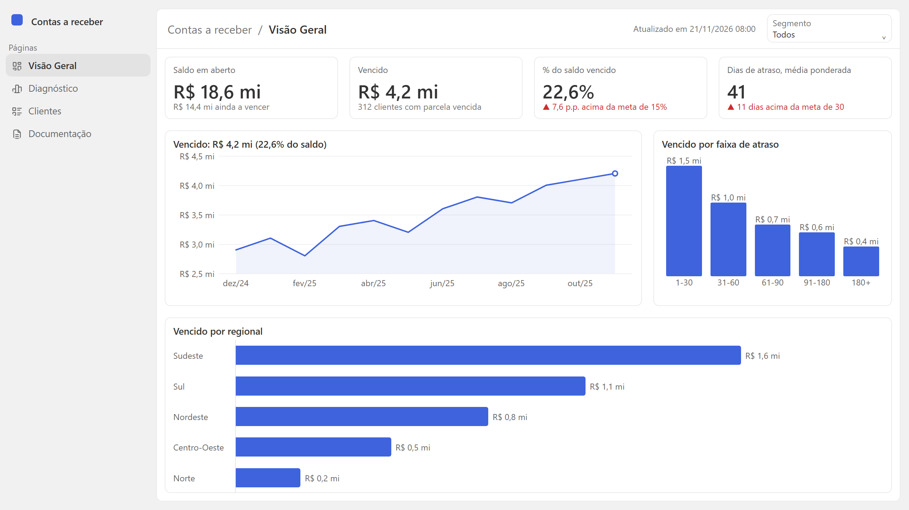

# Com e sem a skill

Este comparativo junta três medições: o benchmark com uma IA trabalhando com e sem a skill, a
reestilização automática de um relatório amador e o relatório de exemplo. Todos os números saem de
ferramentas (schemas da Microsoft, `audit_pbip.py`, `preview_pbir.py --critique`), não de opinião.

## 1. A mesma IA, os mesmos pedidos

No [benchmark](../benchmarks/README.md) da versão 1.5.0, o Claude Sonnet 5.5 recebeu dois pedidos duas
vezes: com a skill e sem ela. Um pedido era montar um relatório de logística a partir de um modelo; o
outro, deixar profissional um relatório amador sem perder informação.

| | Com a skill | Sem a skill |
|---|---|---|
| Requisitos atendidos | **14 de 14** (100%) | 4 de 14 (29%) |
| Entregas que abrem no Power BI sem erro | **2 de 2** | 0 de 2 |
| Nota de harmonia média (0 a 100) | **100** | 0 |
| Achados da auditoria, em média | **1,5** | 33 |
| Visuais com título e texto alternativo | **todos** | faltando nas duas entregas |
| Tokens por execução | 96 mil | 69 mil |
| Tempo por execução | 3 min 44 s | 34 s |

Sem a skill, as duas entregas tinham erros de JSON que impedem o arquivo de abrir (3 e 2 erros), um
achado bloqueador cada, visuais sem texto alternativo e texto cortado. A IA respondeu
"pronto" nas duas.

<table>
<tr><th>Sem a skill</th><th>Com a skill</th></tr>
<tr>
<td></td>
<td></td>
</tr>
</table>

## 2. O mesmo relatório, antes e depois

Um relatório amador (título gigante, pizza, visuais fora da grade, sem texto alternativo) passou pela
reestilização automática: `pbir_layout.py --extract` lê o relatório e o motor o refaz no padrão.

| | Antes | Depois, sem nenhuma edição manual |
|---|---|---|
| Achados da auditoria | 28 | **3** |
| Achados importantes | 8 | **0** |
| Nota de harmonia | 0 | **96** |
| Visuais sem texto alternativo | 7 | **0** |
| Visuais fora da grade de 4 px | 9 | **0** |
| Pizza | 1 | **0** (virou barras ordenadas) |

Os 3 achados que sobram pedem uma decisão humana: dar um nome à página, criar a página de
documentação e decidir sobre uma coluna sem uso.

<table>
<tr><th>Antes</th><th>Depois</th></tr>
<tr>
<td></td>
<td></td>
</tr>
</table>

## 3. O que a skill entrega quando monta o relatório do zero

O [exemplo](../examples/contas-a-receber) passa em todas as conferências: 0 achados na auditoria, nota
100 em todas as páginas, 0 achados na crítica de pixels no computador e no celular, todos os arquivos
válidos nos schemas da Microsoft.

| Na página | Sem a skill, em geral | Com a skill |
|---|---|---|
| Indicadores | cartão com um número solto | rótulo, valor, variação em verde ou vermelho contra o mês anterior ou a meta, minitendência |
| Tendência | linha simples | colunas com o período atual em destaque, comparação com o ano anterior, abas Mês · Trimestre · Ano |
| Composição | pizza com muitas fatias | anel com o total no centro e legenda com valor e percentual |
| Ranking | tabela ou barras iguais | lista com situação em etiqueta colorida, avatar e barra de progresso |
| Navegação | abas do Power BI | menu lateral com seções, contador e data da última carga |
| Filtros | vários, grandes, espalhados | até dois, compactos, no cabeçalho, com filtro de datas e botão de ação |
| Identidade | cores padrão | cor e fonte da empresa em todos os visuais, a partir de uma cor (`make_theme.py`) |
| Celular | não existe | layout de celular gerado junto |

## O custo de não usar

- **Arquivo que não abre.** As duas entregas sem a skill falharam nos schemas da Microsoft. Quem recebe
  descobre só ao abrir no Desktop.
- **Retrabalho de layout.** Visuais fora da grade, espaços desiguais e texto cortado viram horas de
  ajuste manual, página por página.
- **Acessibilidade e conformidade.** Sem título nem texto alternativo, o relatório não funciona com leitor
  de tela e falha em revisões de acessibilidade.
- **Número errado com cara de certo.** A skill confere padrões de DAX e SQL que devolvem número errado
  (média de percentuais, saldo somado ao longo do tempo, divisão sem `DIVIDE`, junção sem chave no SQL). Sem ela, isso só aparece quando alguém
  compara com a origem.
- **"Pronto" sem prova.** Sem a skill, a IA não confere o que entregou. Com ela, cada entrega passa pela
  auditoria, pelo preview e pela crítica de pixels antes de chegar a você.

## O custo de usar

- Cerca de 39% mais tokens e bem mais tempo por pedido (3 min 44 s contra 34 s, em média): a IA lê a
  skill, monta o relatório, audita, gera o preview, critica os pixels e corrige antes de entregar.
- Os visuais da skill são visuais customizados. Empresas que bloqueiam visuais customizados usam os
  nativos equivalentes, com um acabamento mais simples.

## Limites desta comparação

- O benchmark mede a versão 1.5.0, com os visuais novos. As versões 1.3.0 e 1.4.0 foram pontuadas de
  novo com a mesma régua e estão na [página do benchmark](https://davimark.github.io/powerbi-architect/).
- São dois cenários com uma execução por condição. A tendência é clara, mas a amostra é pequena.
- As imagens são do preview da skill, que desenha com o mesmo código dos visuais. Abrir no Power BI
  Desktop continua sendo a conferência final.
