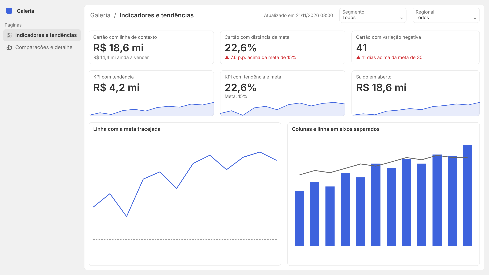
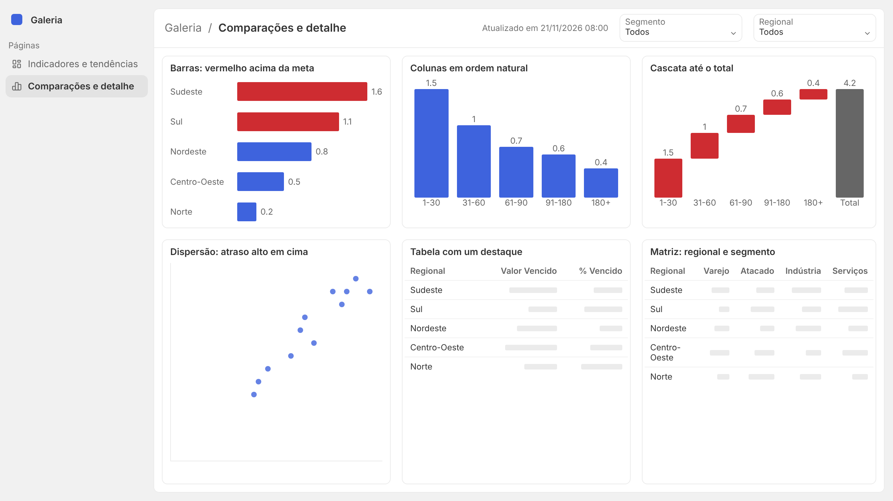

# Galeria de componentes

Todos os visuais que o motor de layout (`scripts/pbir_layout.py`) sabe montar, já no padrão visual da
skill. As imagens foram desenhadas pelo preview a partir de arquivos PBIR de verdade, gerados de
[`layout.json`](layout.json) sobre o modelo do [projeto de exemplo](../../examples/contas-a-receber),
com dados de amostra.



| Componente | Na especificação | Quando usar |
|---|---|---|
| Cartão com linha de contexto | `"type": "kpi"`, `"variation"` | O número principal e uma frase que dá contexto ("R$ 14,4 mi ainda a vencer"). |
| Cartão com distância da meta | `"variation"` e `"variationColor"` | Quando existe meta: seta, distância e cor vinda de uma medida que sabe se subir é bom. |
| KPI com tendência | `"type": "kpiTrend"`, `"trend"`, `"goal"` | Quando o histórico importa tanto quanto o valor. |
| Linha com a meta tracejada | `"type": "lineChart"`, `"target"` | Evolução no tempo comparada a uma meta, com a meta fina, cinza e sem rótulo. |
| Colunas e linha | `"type": "combo"`, `"lineValues"` | Volume e taxa no mesmo eixo de tempo. Com `"target"`, a linha fica no eixo das colunas. |



| Componente | Na especificação | Quando usar |
|---|---|---|
| Barras com cor por medida | `"type": "clusteredBarChart"`, `"colorMeasure"` | Ranking em que algumas barras precisam chamar atenção, como as acima da meta. |
| Colunas em ordem natural | `"type": "clusteredColumnChart"`, `"sort": "category"` | Faixas ordenadas (aging) ou poucos períodos. |
| Cascata | `"type": "waterfallChart"`, `"sentiment"` | Partes que somam um total, como a DRE ou a variação por fator. |
| Dispersão | `"type": "scatter"`, `"x"`, `"y"` | Achar os pontos fora da curva em duas medidas ao mesmo tempo. |
| Tabela com um destaque | `"type": "tableEx"`, `"highlight"` | Quando a pessoa vai agir linha a linha. Uma coluna colorida, no máximo. |
| Matriz | `"type": "matrix"`, `"rows"`, `"columns"` | Duas dimensões cruzadas. |

Alturas das linhas da página:
- número fixo, sempre múltiplo de 4;
- `"auto"`, que cabe o conteúdo (barras: 52 px mais 32 px por categoria, informada em `"items"`);
- `"fill"`, que ocupa o que sobra dos 616 px.

A receita de acabamento de cada visual está em
[`references/chart-craft.md`](../../skills/powerbi-architect/references/chart-craft.md).

Para gerar as imagens de novo:

```bash
python tools/generate_gallery.py
```
