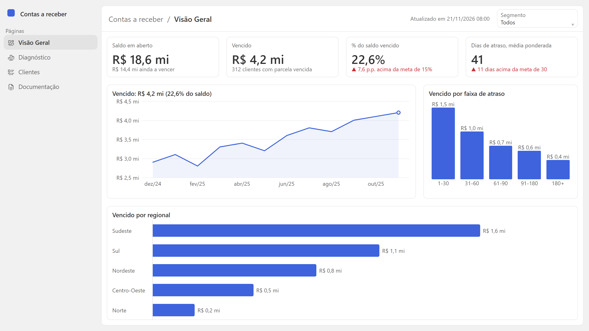
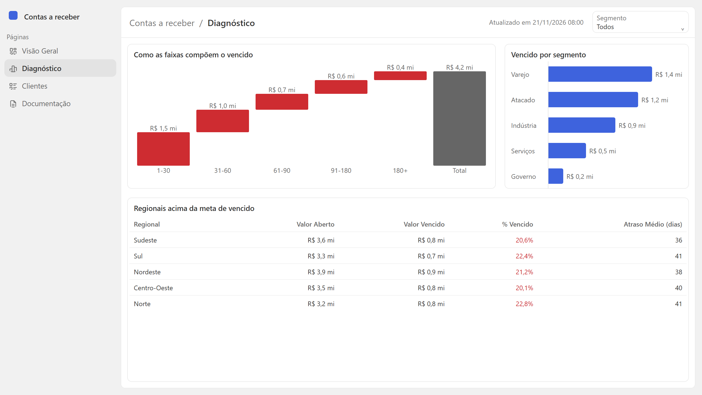
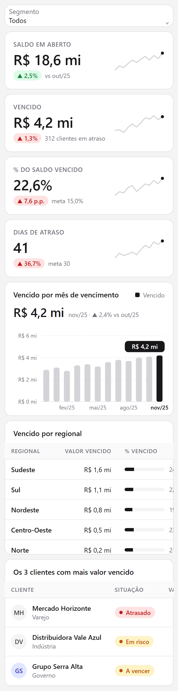
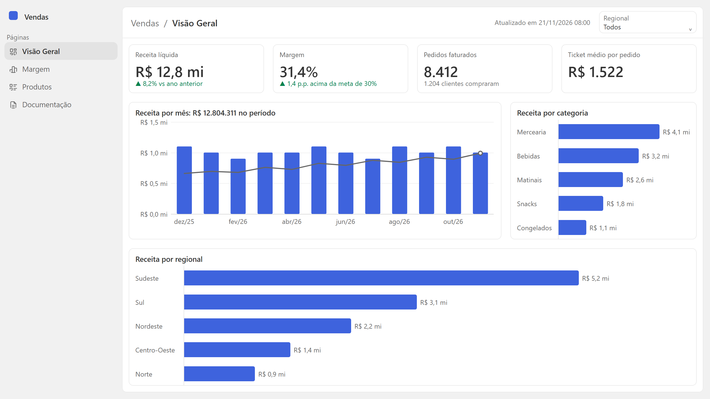
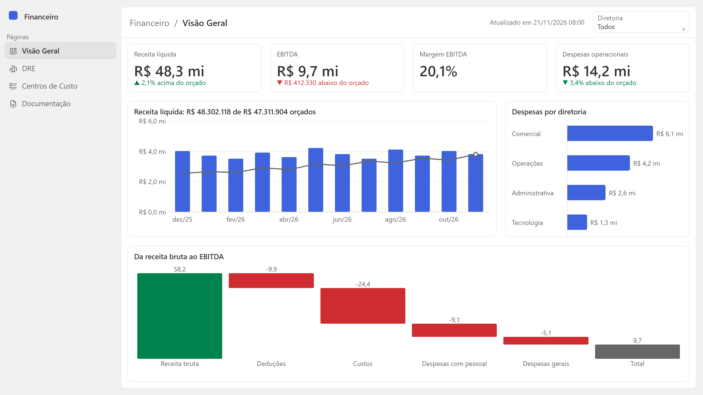
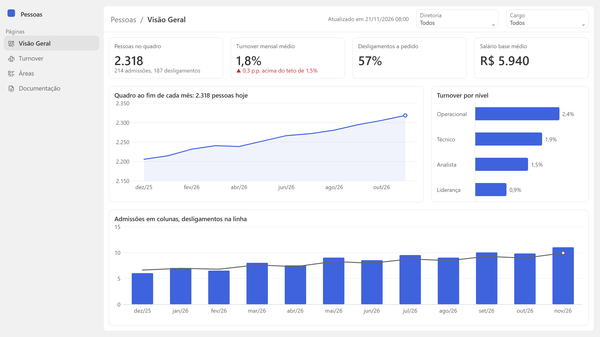
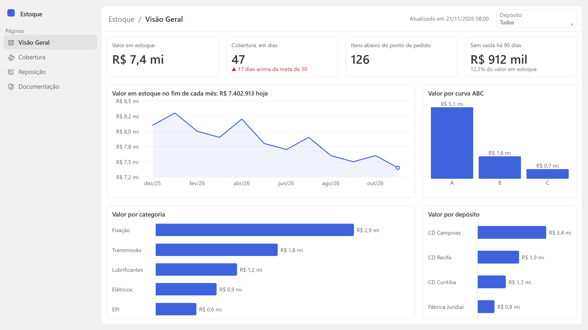
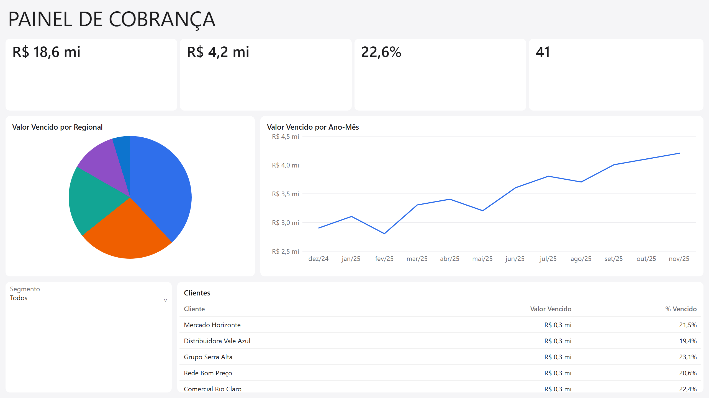
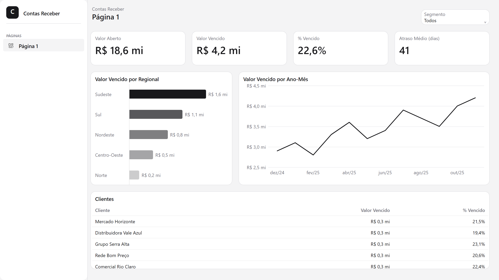

# Guia completo

Tudo o que a skill faz, em detalhe. A apresentação curta está no [README](../README.md).

## Pensa como designer de produto

A parte de design não é "deixar bonito". É começar pela **decisão** que a pessoa precisa tomar e
trabalhar de trás para frente até o pixel; dizer **não** ao visual a mais, à cor a mais, ao filtro
"só por garantia"; cuidar do detalhe que ninguém pediu — alinhamento, formato de número, estado vazio,
tooltip que explica. Arquétipos de página, sistema de layout, tipografia, cor, acessibilidade e um
ritual de revisão estão em [`references/report-design.md`](../skills/powerbi-architect/references/report-design.md).

O padrão visual segue a interface do Twenty, o CRM open source: fundo cinza, sidebar discreta com ícones
e a navegação, painel branco com borda fina, barra do topo com o caminho da página e filtros compactos, uma
só família de fonte (Segoe UI) em tamanhos pequenos e uma cor de destaque.



<sub>Página Visão Geral do [projeto de exemplo](../examples/contas-a-receber), desenhada pela prévia da skill a
partir dos arquivos PBIR, com dados de amostra.</sub>

A IA não monta o relatório "no olho". Ela segue sempre o mesmo ciclo:

1. **Tema:** com a cor da marca, `make_theme.py` gera o tema e escurece a cor até ela passar no contraste.
2. **Layout descrito, não desenhado:** a IA descreve as páginas em linhas de visuais e `pbir_layout.py`
   calcula cada posição na grade de 4 px, com sidebar, barra do topo, KPIs com linha de meta, gráficos,
   tabelas, páginas de drill-through e de tooltip e o layout de celular.
3. **Criticar até não sobrar nada, e só então olhar:** `preview_pbir.py --critique` desenha cada página
   no navegador e mede pixel a pixel:
   - texto cortado ou vazando;
   - valor que não cabe;
   - texto colado na borda;
   - visuais sobrepostos;
   - gutters irregulares;
   - colunas desalinhadas entre linhas;
   - cartões grandes demais para o conteúdo.

   A IA corrige e roda de novo até zerar. Depois abre cada imagem e faz a revisão de três segundos. Os espaçamentos internos dos visuais são aproximações;
   [calibrar o preview](calibrar-preview.md) mostra como compará-los com capturas do Desktop.
4. **Auditar:** `audit_pbip.py` dá uma nota de harmonia de 0 a 100 por página e só aceita entregar com 90
   ou mais.

| Diagnóstico | Celular |
|---|---|
|  |  |

Todos os visuais que o motor monta estão na [galeria de componentes](galeria/README.md).

### Suas edições no Desktop nunca se perdem

Você pode mexer no projeto à vontade no Power BI Desktop ou nos arquivos, entre um pedido e outro, sem
avisar a IA:
- **Ela percebe sozinha.** Antes de cada pedido, um hook compara o projeto com o estado depois da última
  edição da IA. Ela recebe em português o que você mudou: "medida 'Valor Vencido' — expressão mudou",
  "Visão Geral › barras "Vencido por regional" — movido (232, 448) → (240, 448)". Ela trata isso como a
  versão atual e continua a partir dali. O histórico fica em `.powerbi-architect/alteracoes.md`.
- **Ela não escreve por cima.** Ao gerar as páginas de novo, o `pbir_layout.py` faz um merge em três
  vias, como o git:
  - visual que você moveu, redimensionou ou renomeou fica como você deixou;
  - visual que você criou fica, e visual que você apagou continua apagado;
  - o resto segue a especificação nova;
  - quando os dois mudaram a mesma propriedade, vale a sua.

### Começar por um kit do seu domínio

Para não partir do zero, `new_project.py` cria um projeto PBIP completo a partir de um kit: modelo
estrela com `ft_` e `dm_`, uma consulta SQL por tabela, calendário, medidas com descrição e formato,
segurança por linha quando faz sentido, páginas no padrão visual, página de documentação, dados de
amostra para a prévia e um README do projeto. Os quatro kits saem da caixa sem nenhum achado na
auditoria e com nota 100 de harmonia em todas as páginas.

```bash
python skills/powerbi-architect/scripts/new_project.py --list
python skills/powerbi-architect/scripts/new_project.py vendas ./Vendas --primary "#0F766E"
```

| Vendas | Financeiro |
|---|---|
|  |  |
| **Pessoas (RH)** | **Estoque** |
|  |  |

As views de origem citadas no kit não existem no seu data warehouse: o README gerado lista cada uma,
com o grão, para você mapear antes da primeira atualização.

### Reestilizar um relatório que já existe

Não precisa começar do zero. `pbir_layout.py --extract` lê um relatório PBIR com qualquer layout, agrupa
os visuais em linhas pela posição e escreve a especificação equivalente. Também troca pizza por barra
ordenada, descarta a decoração e lista o que precisa de uma pessoa, como texto alternativo, rótulos e a
medida de "atualizado em". Depois é só gerar de novo na mesma pasta:

```bash
python skills/powerbi-architect/scripts/pbir_layout.py --extract MeuRelatorio.Report --out layout.json
python skills/powerbi-architect/scripts/pbir_layout.py layout.json MeuRelatorio.Report
```

| Antes (harmonia 0) | Depois (harmonia 96) |
|---|---|
|  |  |

As páginas são reescritas, então faça um commit antes. Indicadores (bookmarks) que apontam para os
visuais antigos precisam ser refeitos.

## Visual customizado só quando precisa

<picture>
  <source media="(prefers-color-scheme: dark)" srcset="assets/decision-dark.svg">
  
</picture>

Quando o `.pbiviz` é mesmo necessário, a skill traz um **visual de referência real**
([`templates/pbiviz-bullet-kpi`](../skills/powerbi-architect/templates/pbiviz-bullet-kpi)) que **compila,
passa no ESLint oficial e é empacotado pelo `pbiviz package` sem nenhum aviso de recurso recomendado**:
eventos de renderização, landing page, seleção e multisseleção, menu de contexto, tooltips, highlights,
localização (en-US/pt-BR), teclado, alto contraste, `allowInteractions` — e **sem acesso à rede**.
O CI deste repositório reconstrói o pacote a cada mudança.

## Instalação

**Claude Code**, em um comando:

```text
/plugin install powerbi-architect --marketplace DaviMark/powerbi-architect
```

**Sem terminal** (Claude.ai e outras ferramentas que aceitam upload de skill): baixe
`powerbi-architect-vX.Y.Z.zip` na [última release](https://github.com/DaviMark/powerbi-architect/releases/latest).

**Todas as IAs no seu repositório** (Claude Code, GitHub Copilot, Cursor, Codex, Gemini CLI):

```bash
git clone https://github.com/DaviMark/powerbi-architect.git
```

| Onde | Comando |
|---|---|
| No seu repositório (todas as IAs) | `./powerbi-architect/install/install.sh /caminho/do/repo` |
| Windows (PowerShell) | `.\powerbi-architect\install\install.ps1 -Target C:\caminho\do\repo` |
| Global (todos os projetos) | `./powerbi-architect/install/install.sh --global` |
| Sempre atualizada (symlink) | `./powerbi-architect/install/install.sh /caminho/do/repo --link` |

O instalador **copia a skill** para `.claude/skills/` (Claude Code, Cursor), `.github/skills/`
(GitHub Copilot) e `.agents/skills/` (Codex e outros). Depois **gera o grafo de conhecimento** do
repositório (abaixo). Nada é baixado. Para só copiar arquivos, use `--no-graph` (bash) ou `-NoGraph`
(PowerShell). Para gerar o grafo sem hooks, use `--no-hooks` ou `-NoHooks`.
Depois é só pedir trabalho de Power BI — a IA carrega a skill sozinha (ou diga *"use a skill powerbi-architect"*).

**Atualizar:** `git pull` na pasta clonada e depois `install.sh /caminho/do/repo --update` (ou
`install.ps1 -Target C:\caminho\do\repo -Update`). Só as instalações mais antigas são trocadas. Para ver a
versão instalada sem mudar nada, use `--status` (ou `-Status`).

> Usa o **Power BI Modeling MCP** da Microsoft? A skill detecta e prefere o MCP para alterar o
> modelo e **executar DAX de validação**; sem ele, edita TMDL/PBIR direto, com segurança.

## Grafo de conhecimento: menos tokens por pergunta

Na instalação, o `scripts/pbi_graph.py` lê todos os projetos PBIP do repositório: modelo TMDL,
relatório PBIR, SQL das cargas, `ficha.toml` e documentação. Ele usa só Python padrão, roda
offline e lê só metadados. O resultado vai para `powerbi-graph/`:

| Arquivo | Para quê |
|---|---|
| `GRAPH_REPORT.md` | 1 página: dashboards, modelos, hubs, comunidades e achados (colunas e medidas sem uso, campos quebrados em visuais, fontes compartilhadas, medidas com DAX divergente) |
| `wiki/<modelo>.md` | card por modelo: tabelas, colunas, DAX, relacionamentos, páginas e campos de cada visual |
| `graph.json` · `graph.html` | grafo completo (pronto para GraphRAG) e visualização interativa offline |

A IA lê o relatório e o card em vez de dezenas de `*.tmdl` e `visual.json`. No
[projeto de exemplo](../examples/contas-a-receber), que é pequeno, ~18,9 mil tokens de fonte viram um
relatório de ~1 mil e um card de ~1,3 mil (19 vezes menos); a economia cresce com o tamanho do projeto.
Os comandos abaixo funcionam sobre ele. Para buscas pontuais:

```bash
python .claude/skills/powerbi-architect/scripts/pbi_graph.py query   "o que alimenta a página Visão Geral?"
python .claude/skills/powerbi-architect/scripts/pbi_graph.py explain "Valor Vencido"
python .claude/skills/powerbi-architect/scripts/pbi_graph.py impact  "ft_titulos[Dias Atraso]"   # o que quebra se eu mudar
python .claude/skills/powerbi-architect/scripts/pbi_graph.py path    "Regional" "Valor Vencido"
```

O instalador também deixa o grafo sempre em uso e atualizado:
- adiciona uma seção curta no `AGENTS.md` e no `CLAUDE.md`, que manda a IA consultar o grafo antes de abrir arquivos;
- cria hooks do Claude Code (início de sessão e após cada edição);
- audita o relatório ou o modelo logo após cada edição feita pelo Claude Code: se surgir um bloqueador
  ou uma página abaixo de 90 no placar de harmonia, o agente recebe os achados na hora e corrige antes
  de seguir;
- avisa a IA, antes de cada pedido, do que você mudou à mão no Desktop ou nos arquivos;
- cria hooks do git (`post-commit`, `post-merge`, `post-checkout`).

Rodar de novo não duplica nada. `pbi_graph.py uninstall` remove tudo. Detalhes em
[`references/graph.md`](../skills/powerbi-architect/references/graph.md).

## O que tem dentro

```text
skills/powerbi-architect/
├── SKILL.md                        ← núcleo: leis, workflow, árvores de decisão (carregado primeiro)
├── references/                     ← carregados sob demanda (economiza contexto)
│   ├── workflow.md                 fases, gates, modo standalone x Power BI Workspaces
│   ├── modeling.md                 grão, star schema, chaves, datas, import mínimo, storage modes
│   ├── power-query.md              política de 1 etapa, 8 conectores, dialetos SQL, incremental
│   ├── dax.md                      camadas, padrões, time intelligence, performance, anti-padrões, testes
│   ├── tmdl.md                     sintaxe TMDL com exemplos validados
│   ├── pbir.md                     JSON de páginas/visuais, papéis por tipo de visual, regras de schema
│   ├── report-design.md            design de produto: layout, arquétipos, cor, tipografia, acessibilidade
│   ├── visual-selection.md         pergunta → visual nativo; quando (não) criar .pbiviz
│   ├── custom-visuals.md           .pbiviz de ponta a ponta, segurança de certificação, checklist
│   ├── documentation.md            página Documentação (INFO.VIEW), README, descrições
│   ├── refactoring.md              legado → padrão com paridade numérica
│   ├── graph.md                    grafo de conhecimento: o que lê, saídas, comandos, hooks
│   ├── semantic-features.md        calculation groups, field parameters, visual calculations, funções DAX
│   ├── fabric-and-cicd.md          Direct Lake, Git do Fabric, deployment pipelines, CI
│   ├── copywriting.md              títulos, nomes de medida, números e textos das páginas
│   ├── chart-craft.md              receita de acabamento de cada visual, formatos de número, revisão de 3 segundos
│   ├── numbers.md                  provar os números: reconciliação, armadilhas de DAX, SQL e M, Python
│   ├── performance.md · security.md · quality-checklist.md
├── templates/
│   ├── starter-kits/               ← kits de vendas, financeiro, RH e estoque
│   ├── pbir-pages/                 ← 6 arquétipos de página e um layout de exemplo
│   ├── pbir-visuals-experimental/  ← cartão novo, slicer em botões, botão com ícone (a conferir no Desktop)
│   ├── icons/                      ← ícones da navegação (Tabler, licença MIT)
│   ├── theme/                      ← tema acessível (contraste conferido, schema oficial)
│   └── pbiviz-bullet-kpi/          ← visual customizado de referência (verificado)
└── scripts/
    ├── audit_pbip.py               ← auditoria de qualquer pasta PBIP, com nota de harmonia por página
    ├── pbi_graph.py                ← grafo de conhecimento + query/explain/impact/path
    ├── pbir_layout.py              ← gera as páginas a partir de um layout em JSON; --extract reestiliza
    ├── preview_pbir.py             ← prévia das páginas em HTML, sem o Power BI Desktop
    ├── make_theme.py               ← tema a partir da cor da marca, com contraste conferido
    ├── new_project.py              ← projeto PBIP completo a partir de um kit inicial
    ├── pbip_changes.py             ← percebe o que você mudou à mão e conta para a IA
    └── reconcile.py                ← compara os números do relatório com os da origem, linha a linha

examples/contas-a-receber/          ← projeto PBIP completo que segue todas as regras
```

A auditoria aponta cada problema com código, arquivo e linha, e diz qual regra do Best Practice
Analyzer do Tabular Editor é equivalente. Gera também SARIF, para os achados aparecerem nos pull requests
do GitHub. Lista de regras e como silenciar uma delas: [docs/regras-auditoria.md](regras-auditoria.md).

```bash
python skills/powerbi-architect/scripts/audit_pbip.py caminho/do/projeto-pbip
python skills/powerbi-architect/scripts/audit_pbip.py caminho/do/projeto-pbip --sarif > auditoria.sarif
```

## Segurança

| Receio | Resposta |
|---|---|
| "Uma skill pode executar coisas no meu PC?" | Esta skill é **texto** (Markdown) + dois scripts Python legíveis, sem dependências e sem rede. O instalador copia arquivos e roda só o `pbi_graph.py`, que lê metadados e escreve em `powerbi-graph/`, `AGENTS.md`/`CLAUDE.md` e nos hooks (`.claude/settings.json`, `.git/hooks`). Use `--no-graph` para não executar nada. |
| "A IA vai mexer nos meus dados?" | A skill proíbe `.pbix`/dados/senhas no repositório e trata pedidos, anexos, PDFs e arquivos legados como **dados, nunca instruções** (proteção contra prompt injection). |
| "E o visual customizado?" | `privileges: []` (sem rede, sem storage), sem `eval`/`innerHTML`, lint oficial; o teste do repositório garante isso. |
| "A IA publica sozinha?" | Não. Dois gates humanos: aprovação do desenho e conferência dos números. |

Detalhes em [SECURITY.md](../SECURITY.md).

## Explorador do Power BI

`pbi_graph.py view` abre o `powerbi-graph/graph.html`: uma página só, sem internet, com seis vistas.

| Vista | O que mostra |
|---|---|
| Grafo | tabelas, colunas, medidas, páginas, visuais e fontes ligados; clique para ver as ligações, duplo clique para isolar |
| Modelo | o esquema estrela de cada modelo, com cardinalidade, chaves e colunas sem uso |
| Medidas | catálogo por pasta, com descrição, formato, DAX colorido, dependências e onde cada uma aparece |
| Relatórios | cada página em escala, com os visuais na posição real; clique para ver os campos |
| Identidade | cores, significado (bom, ruim, neutro) e fonte do tema de cada relatório |
| Achados | colunas e medidas sem uso, referências quebradas, páginas lotadas e mais |

O endereço aceita a vista no final (`graph.html#modelo`, `#medidas`, `#relatorios`). Funciona em
qualquer repositório com projetos PBIP, inclusive dentro do [Power BI Workspaces](https://github.com/DaviMark/powerbi-workspaces).
