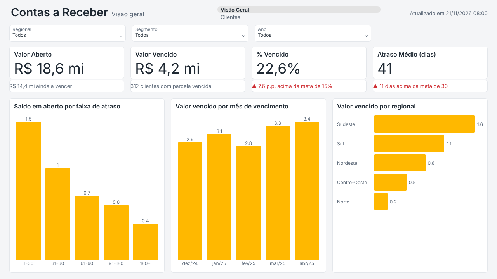
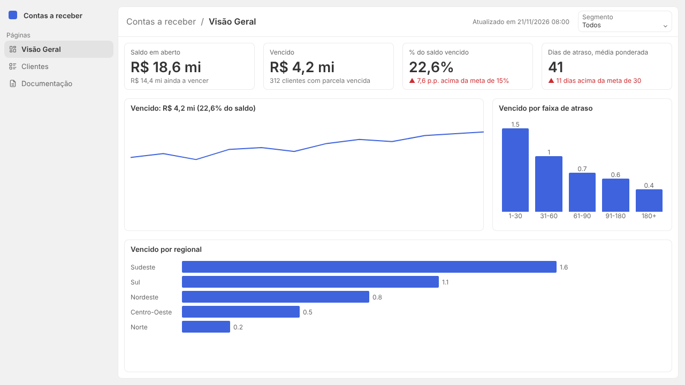

# Avaliações de design · 21/11/2026

Comparação da mesma IA criando relatório e tema **sem** e **com** a skill powerbi-architect, nos casos
E11 e E12 de [`cases.md`](../../cases.md). Diferente da [rodada anterior](../2026-11-21/README.md), a nota
aqui não depende de avaliador: quem corrige são as próprias ferramentas (auditoria, schemas oficiais da
Microsoft e cálculo de contraste).

## Resumo

| | Sem a skill | Com a skill |
|---|---|---|
| Itens atendidos | **3 de 8** | **8 de 8** |
| E11 · nota de harmonia por página | Visão Geral **0** · Clientes **22** | Visão Geral **100** · Clientes **100** · Documentação **100** |
| E11 · achados da auditoria | 1 bloqueador · 29 importantes · 17 sugestões | 0 · 0 · 1 sugestão (README do projeto) |
| E12 · contraste | cor da marca 1,73:1 na paleta; texto terciário 2,5:1 | tudo acima de 3:1 (gráficos) e 4,5:1 (texto) |

### E11 · Relatório a partir do modelo

| Item | Sem a skill | Com a skill |
|---|---|---|
| Zero bloqueadores | não (sem página de Documentação) | sim |
| Todas as páginas com harmonia ≥ 90 | não (0 e 22) | sim (100) |
| JSON válido nos schemas da Microsoft | sim (29 arquivos) | sim (70 arquivos) |
| Sem slicer grande, fonte fora da escala, visual fora da grade ou da página | não: 6 slicers grandes, 6 fontes acima da escala, 9 visuais fora da grade | sim |

Outros achados sem a skill: 14 visuais sem texto alternativo, 3 slicers na mesma página e 6 visuais sem
título. Detalhes em [`without/E11-audit.json`](without/E11-audit.json) e [`with/E11-audit.json`](with/E11-audit.json).

| Sem a skill | Com a skill |
|---|---|
|  |  |

As duas imagens foram desenhadas por `scripts/preview_pbir.py` a partir dos arquivos PBIR gerados, com os
mesmos dados de amostra. À primeira vista a página sem a skill é razoável. A diferença está no que a
auditoria mede: o amarelo da marca usado nas barras (1,73:1 sobre o fundo claro), slicers de 300 px,
título de 20 pt, navegação de páginas espremida no topo, visuais fora da grade e sem texto alternativo.

### E12 · Tema da marca (#FFB800)

| Item | Sem a skill | Com a skill |
|---|---|---|
| Válido no schema oficial de temas | sim | sim |
| Todo texto com contraste ≥ 4,5:1 | não: terciário `#9AA5B1` com 2,5:1 | sim |
| ≤ 6 cores de categoria, cada uma ≥ 3:1, sem vermelho/verde de status | não: 10 cores, a primeira (`#FFB800`) com 1,73:1 | sim: 6 cores, a da marca escurecida para `#996E00` (4,58:1) |
| Uma família de fonte que o Power BI renderiza | sim (Segoe UI) | sim (Segoe UI) |

Temas gerados: [`without/E12-theme.json`](without/E12-theme.json) e [`with/E12-theme.json`](with/E12-theme.json).

## Como foi feito

1. **Modelo:** Claude Sonnet 5.5, como subagente do Claude Code, uma execução por condição. Com a skill, a
   IA lia o `SKILL.md` e usava os scripts dela; sem a skill, não podia abrir nada do repositório.
2. **Material:** o modelo semântico do projeto de exemplo, sem nenhum arquivo de relatório, conforme
   [`fixtures/E11-E12-design.md`](../../fixtures/E11-E12-design.md).
3. **Correção:** `audit_pbip.py` (bloqueadores, regras de layout e nota de harmonia),
   `tools/validate_schemas.py` (schemas da Microsoft) e o cálculo de contraste de `make_theme.py`. Nenhum
   item depende de opinião.

## Limitações

- **O caso favorece a skill.** O modelo do E11 é o mesmo do projeto de exemplo, e a skill traz um layout
  pronto para ele (`templates/pbir-pages/layout-example.json`). A execução com a skill partiu desse
  layout ([`with/E11-layout.json`](with/E11-layout.json)). A próxima rodada precisa de um modelo diferente.
- **A nota de harmonia é da própria skill.** Ela mede as regras que a skill ensina, então a execução sem a
  skill não tinha como conhecê-las. Os itens de schema, contraste e fonte são critérios gerais.
- **A IA com a skill não olhou a prévia.** Ela gerou o HTML, mas sem uma ferramenta de imagem não o viu.
  Por isso, `preview_pbir.py --png` passou a usar o Edge ou o Chrome da própria máquina, e o `SKILL.md`
  agora exige abrir cada imagem.
- **Um modelo de IA, uma execução, nada aberto no Power BI Desktop.** Os relatórios completos não foram
  guardados; ficaram a auditoria, o layout, os temas e as imagens.
