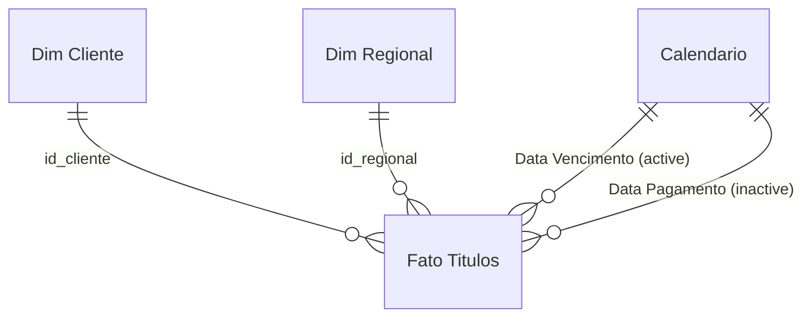

# Gate 1: design for approval (no model built yet)

**Source:** `bi.vw_titulos_receber` (SQL Server), 60 columns. **I import 13 of the 60** (47 are cut, listed below). Storage: Import.

## 1. Questions, and what each needs
| # | Question | Needs |
|---|---|---|
| Q1 | Overdue today by regional and segment | open balance, due date, regional, segment |
| Q2 | Average days past due, weighted by open balance, per month, 24 months | days overdue, open balance, month |
| Q3 | Top 20 customers by overdue amount and their share of the total | customer, overdue amount |
| Q4 | Received per month vs due per month | payment date and amount, due date and original amount |

## 2. Model
**Grain of the fact:** 1 row per receivable title (installment) in the view. This is a transaction fact with open balance.

| Table | Type | Columns imported | Source |
|---|---|---|---|
| **Fato Titulos** | fact | `id_cliente`, `id_regional` (hidden keys) · `Data Vencimento`, `Data Pagamento` · `Valor Original`, `Valor Aberto`, `Valor Pago` · `Dias Atraso` (int, computed in SQL: days from due date to today for titles with an open balance, otherwise 0) | the view, one native SQL |
| **Dim Cliente** | dimension | `id_cliente` (key), `Cliente`, `Segmento` | the view, `SELECT DISTINCT` |
| **Dim Regional** | dimension | `id_regional` (key), `Regional` | the view, `SELECT DISTINCT` |
| **Calendario** | date dimension | date, year, month and month number (sorted), year-month | calculated table or source date dim, marked as date table, auto date/time off |

Relationships are one-to-many, single direction, from dimension to fact. Due date is the active relationship to Calendario. Payment date is inactive and used with `USERELATIONSHIP` in Q4.

## 3. Metrics (all in `_Medidas`, each with description, format and folder)
| Folder | Measure | Definition | Sketch |
|---|---|---|---|
| Valores | Saldo em Aberto | Open amount still to be received | `SUM(Valor Aberto)` |
| Valores | Valor Vencido | Open amount with due date before today | `CALCULATE([Saldo em Aberto], 'Fato Titulos'[Dias Atraso] > 0)` |
| Valores | Valor Recebido | Amount received, by payment date | `CALCULATE(SUM(Valor Pago), USERELATIONSHIP(Data Pagamento, Calendario[Data]))` |
| Valores | Valor a Receber no Mês | Original amount of titles due in the period | `SUM(Valor Original)` (by due date) |
| Indicadores | Atraso Médio Ponderado (dias) | Days past due weighted by open balance | `DIVIDE(SUMX(Fato, [Valor Aberto] * [Dias Atraso]), [Valor Vencido])` |
| Indicadores | % do Total Vencido | Customer share of total overdue | `DIVIDE([Valor Vencido], CALCULATE([Valor Vencido], ALLSELECTED('Dim Cliente')))` |
| Indicadores | Ranking Cliente | Rank by overdue amount | `RANKX` over `ALLSELECTED` customers, used for Top 20 |

## 4. Pages (1280x720, a headline that states the conclusion, 8 visuals or fewer)
- **Visão Geral.** Question: where is our overdue balance concentrated?
  Visuals: 3 KPIs (Valor Vencido, % do total em aberto, Atraso Médio) · bar of overdue by regional · bar of overdue by segment · line of Atraso Médio per month (24 months) · bar of Top 20 customers with data labels showing share.
- **Recebido vs a Receber.** Question: are we collecting what falls due? Visuals: 2 KPIs · clustered column, due vs received per month.
- **Documentação.** Metrics catalog and loads.

## 5. Not imported (47 columns), by reason
- **Personal and contact data (LGPD):** cpf/cnpj, e-mail, phone, address, city, UF (customer), salesperson name and e-mail, branch CNPJ.
- **Audit and technical:** `data_cadastro`, `data_alteracao`, `usuario_*`, `hash_integracao`, `chave_nfe`, `linha_digitavel`, `nosso_numero`, `id_titulo_origem`.
- **Banking and accounting detail not asked:** bank, agency, account, portador, forma de pagamento, centro de custo, conta contábil.
- **Fiscal and order IDs, free text:** invoice number and series, `id_pedido`, `observacao`, `numero_titulo`, `parcela`, `id_titulo`.
- **Valor extras not asked:** juros, multa, desconto, abatimento, moeda and câmbio (see decision 3).
- **Other dates and attributes:** original due date, `data_baixa`, branch and salesperson, risk class, protested and renegotiated flags, `id_*` of unused dimensions.

## 6. Open decisions (I need your answer before building)
1. **Q2 "per month".** The view is probably today's snapshot, so it has no history of past balances. Recommendation: group by **due month** (average days late of titles that fell due in that month and are still open). A true month-end snapshot needs a historical table and is a different model.
2. **Which titles count?** I filter in the SQL `WHERE` and do not import `status_titulo`. Please confirm which statuses to exclude (cancelled, renegotiated?).
3. **Currency.** Is everything in one currency? If not, I need to know which currency to report in and the exchange rate rule.
4. **Regional.** Is it the regional of the branch (my recommendation) or of the customer? I use `id_regional` from the title row either way.
5. **Q4 "due".** I use `valor_original` by due date as "due". Should it be the open plus paid amount, or the original value?

`Dias Atraso` is calculated at refresh, so it is as of the last refresh date. I will state that on the Documentation page.

Approve, or tell me what to change. After approval I will write the SQL, the TMDL and the pages, and I will not claim the numbers are right until you confirm them against a control total (Gate 2).
