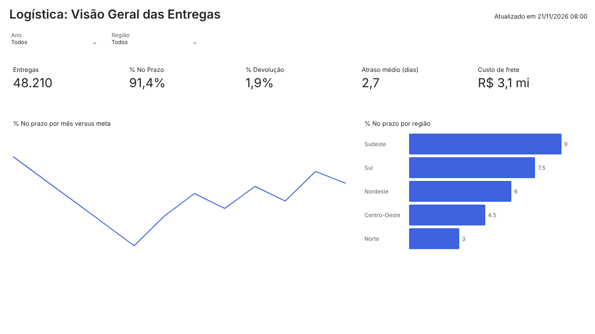
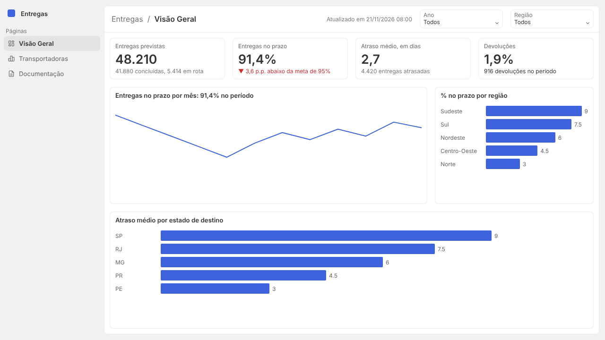
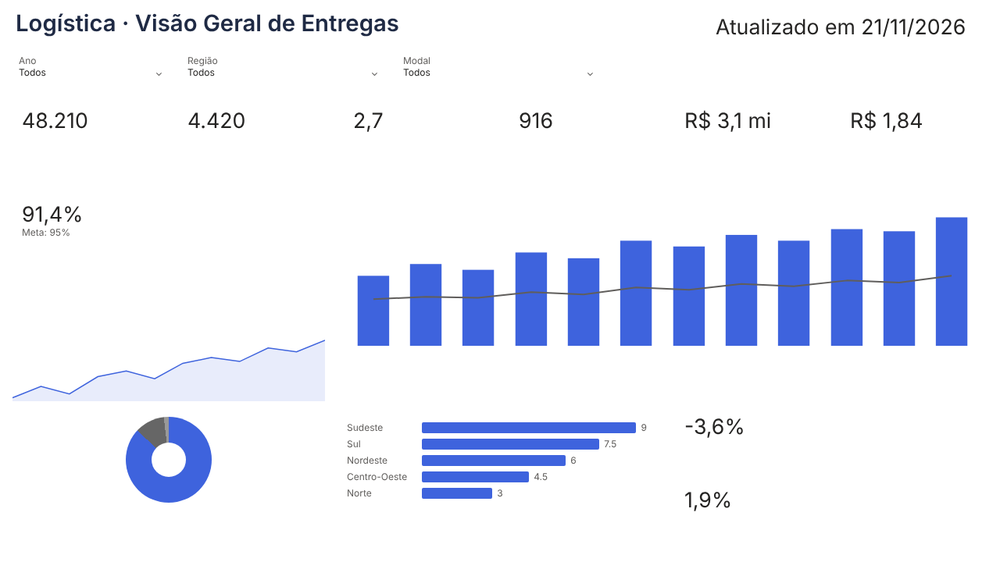
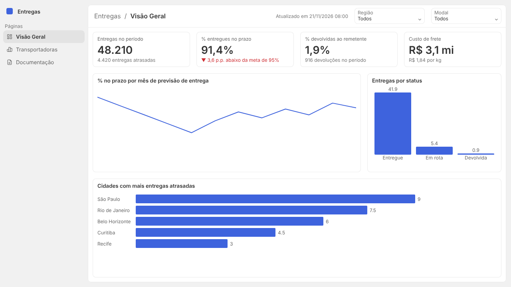

# Avaliação de design E13 · 22/11/2026

A rodada anterior ([E11/E12](../2026-11-21-design/README.md)) tinha uma limitação: o modelo era o do
projeto de exemplo, para o qual a skill já trazia um layout pronto. O caso E13 usa um modelo de
**logística de entregas** que não existe em nenhum lugar da skill (nem nos kits iniciais). Ele foi
repetido com **dois modelos de IA**, cada um **com e sem** a skill, e ganhou um avaliador cego.

## Resumo

| | Sonnet sem | Sonnet com | Haiku sem | Haiku com |
|---|---|---|---|---|
| Itens atendidos (de 4) | **0** | **4** | **0** | **4** |
| Harmonia por página | 0 · 0 | 100 · 100 · 100 | 0 · 0 | 100 · 100 · 100 |
| Achados da auditoria (bloqueador · importante · sugestão) | 1 · 20 · 12 | 0 · 0 · 1 | 1 · 28 · 42 | 0 · 0 · 2 |
| Erros nos schemas da Microsoft | 1 em 24 arquivos | 0 em 78 | 3 em 30 | 0 em 78 |
| Visuais sem texto alternativo · sem título | 12 · 2 | 0 · 0 | 17 · 17 | 0 · 0 |
| Preferido pelo avaliador cego | não | **sim** (confiança alta) | não | **sim** (confiança alta) |

As únicas sugestões que sobraram com a skill são a falta de README do projeto (as duas execuções) e uma
coluna importada sem uso (Haiku).

## O caso

**Pedido:** "Crie o relatório deste modelo em PBIR: uma página de visão geral para a diretoria de
logística e uma página comparando as transportadoras, em `Entregas.Report`."

**Material:** modelo semântico de entregas, transportadoras e cidades, com prazo, atraso, devoluções e
frete, sem nenhum arquivo de relatório ([`fixtures/E13-entregas.md`](../../fixtures/E13-entregas.md)).

**Itens (todos medidos por ferramenta, menos o último):**
1. Zero bloqueadores e todo JSON válido nos schemas da Microsoft.
2. Todo visual de dados com texto alternativo e título (`PBI019`, `PBI056`).
3. Todas as páginas com harmonia ≥ 90.
4. Preferido por um avaliador cego.

## Visão Geral

| Sem a skill | Com a skill |
|---|---|
|  |  |
|  |  |

Linha de cima: Sonnet. Linha de baixo: Haiku. As imagens das páginas de transportadoras estão em
[`sem/`](sem) e [`com/`](com). Todas foram desenhadas por `scripts/preview_pbir.py` a partir dos arquivos
PBIR gerados, com os mesmos dados de amostra ([`amostra.json`](amostra.json)).

## Avaliador cego

Um terceiro agente, de outro modelo (Opus), recebeu só as imagens, em pares chamados A e B, com a ordem
trocada entre os pares. Ele não sabia que havia uma skill envolvida. Deu notas de 1 a 5 em hierarquia,
alinhamento, legibilidade, cor com significado e resposta ao pedido.

| Critério | Sonnet sem | Sonnet com | Haiku sem | Haiku com |
|---|---|---|---|---|
| Hierarquia | 3 | 4 | 1 | 4 |
| Alinhamento e espaçamento | 3 | 4 | 2 | 4 |
| Legibilidade | 2 | 4 | 1 | 3 |
| Cor com significado | 1 | 3 | 1 | 3 |
| Responde ao pedido | 2 | 4 | 2 | 4 |

Nas palavras do avaliador:
- **Com a skill:** os cartões de KPI trazem uma linha de contexto ("▼ 3,6 p.p. abaixo da meta de 95%" em
  vermelho), então a visão geral diz à diretoria como as entregas estão em relação à meta. A ordem de
  leitura é clara: KPIs, tendência, quebra e detalhe.
- **Sem a skill:** KPIs como números soltos, sem comparação; no Haiku, seis números sem rótulo, nenhum
  título de visual, rosca sem rótulos e rótulos cortados no gráfico de colunas. No Sonnet, o gráfico
  "versus meta" não mostra a meta, e há faixas grandes vazias.

## O que ainda falta, mesmo com a skill

O avaliador também apontou fraquezas nas versões com a skill, e elas viram trabalho:
- **Tendência sem a linha da meta.** O gráfico de "% no prazo" não mostra os 95%. A skill precisa
  orientar a meta como segunda série em cinza, ou como linha de referência.
- **Uma cor só.** Todas as barras usam o mesmo azul. Barras que ficam abaixo da meta poderiam ser
  destacadas pela cor, o que o motor de layout ainda não faz.
- **Espaço vazio.** Cartões de barras com 5 categorias em linhas de 248 px deixam sobra embaixo. Falta uma
  regra de altura por número de barras.
- **Título errado.** Na execução do Haiku, a página de transportadoras reaproveitou o título dinâmico da
  tendência mensal. A auditoria não tem como saber que o texto não corresponde ao visual.

Uma das execuções sem a skill ainda achou um problema real nos kits: o calendário começava no ano
anterior, mas as tabelas fato cobrem 24 meses. Isso já foi corrigido.

## Limitações

- **Uma execução por condição**, e nada aberto no Power BI Desktop.
- **A nota de harmonia é da própria skill**, então a execução sem a skill não tinha como conhecer as
  regras dela. Por isso esta rodada acrescentou os schemas da Microsoft, texto alternativo, títulos e
  um avaliador cego, que são critérios gerais.
- **O avaliador é um modelo de IA**, não uma pessoa, e julgou imagens desenhadas pelo preview, não o
  relatório renderizado pelo Power BI.
- Os arquivos guardados são os relatórios de auditoria ([`com/`](com), [`sem/`](sem)), os layouts das
  execuções com a skill e as imagens. Os relatórios PBIR completos não foram guardados.
