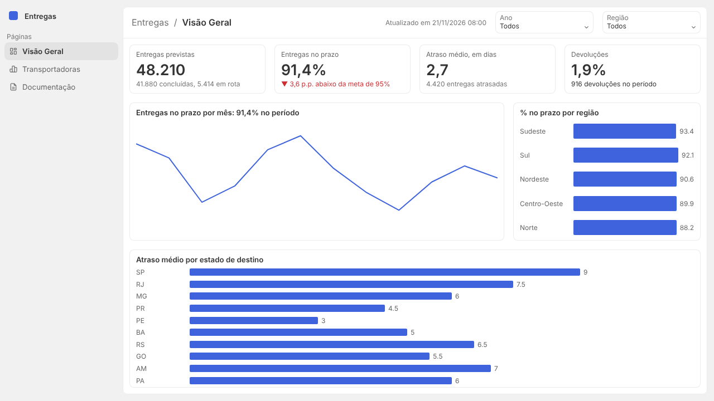
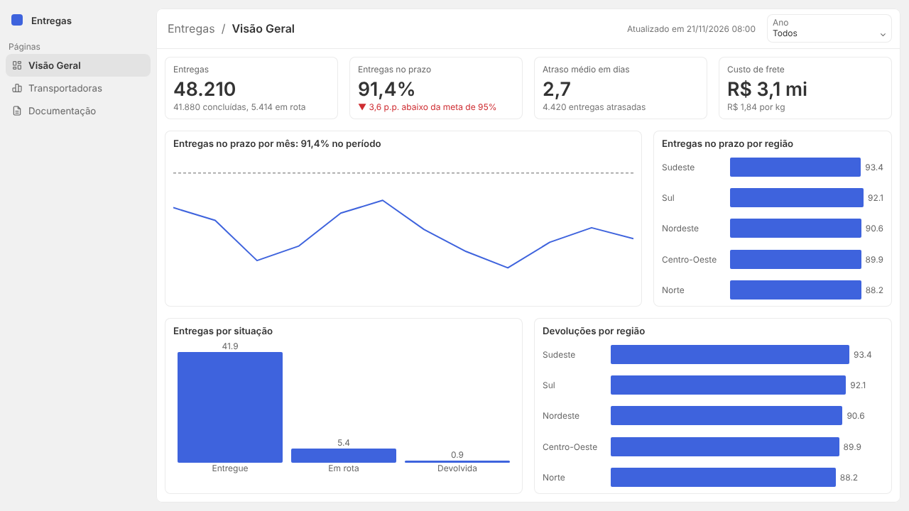
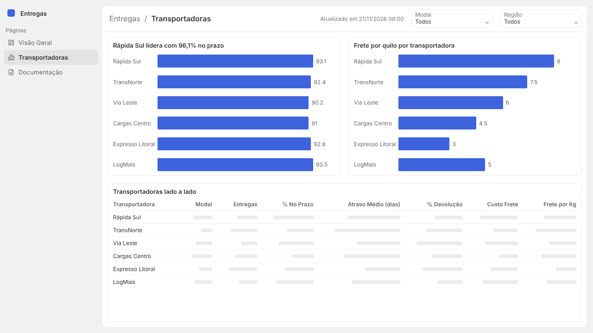
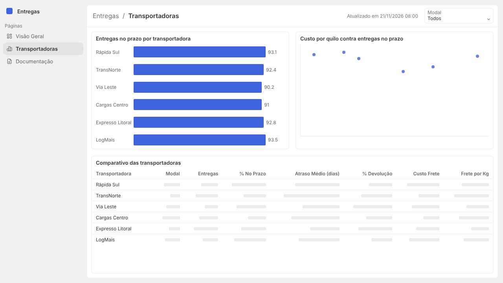

# Avaliações E13 (rodada 2) e E14 · 24/11/2026

Duas perguntas:
1. As melhorias de design desde a rodada 1 da E13 mudam o que um avaliador cego vê?
2. Quando o usuário mexe no projeto à mão, a IA preserva o que ele fez e continua a partir dali (E14)?

Os resultados estão aqui como saíram, inclusive o que não foi a favor da skill.

## E14 · Edições feitas à mão sobrevivem ao próximo pedido

Caso em [`cases.md`](../../cases.md) e montagem em [`fixtures/E14-edicoes-manuais.md`](../../fixtures/E14-edicoes-manuais.md).
O kit de vendas foi gerado e, depois da última edição da IA, recebeu três edições como se fossem feitas
no Power BI Desktop:
- um gráfico estreitado e renomeado;
- um gráfico novo criado pelo usuário;
- a meta de margem trocada de 30% para 32%.

Depois disso, a IA recebeu o pedido de uma página nova, sem ser avisada das edições.

| Verificação | Sem a skill | Com a skill, 1ª execução | Com a skill, depois da correção |
|---|---|---|---|
| Título, largura e posição do usuário mantidos | sim | sim | sim |
| Gráfico criado pelo usuário mantido | sim | sim, **mas duplicado** | sim, sem cópia |
| Meta de 32% mantida | sim | sim | sim |
| Página Clientes criada, zero bloqueadores | sim | sim | sim |
| Harmonia da Visão Geral | 96 | 82 (cópia e 9 visuais) | 96 |
| Avisou o usuário das edições que encontrou | sim | sim | sim |

O que isso mostra:
- **A primeira execução com a skill achou um bug real.** A IA extraiu a especificação do relatório
  editado e gerou de novo. O gráfico criado pelo usuário entrou na especificação com outro
  identificador, e o motor criou uma cópia dele. A correção foi feita na hora (o `--extract` passou a
  fixar páginas e visuais nas pastas existentes), e a segunda execução confirmou. A regra `PBI069`, criada
  depois, também aponta essa cópia.
- **Sem a skill, as edições também sobreviveram neste caso.** A IA editou os arquivos à mão, só
  acrescentando, e isso não apaga nada. Ela não registrou o novo estado do projeto, e a especificação do
  relatório não ficou atualizada.
- **As duas execuções disseram que o `layout.json` não existia, mas ele estava na pasta.** Com a skill, a
  IA então extraiu a especificação, que foi o caminho que revelou o bug.

Arquivos: [`e14-sem-verificacao.txt`](e14-sem-verificacao.txt), [`e14-com-verificacao.txt`](e14-com-verificacao.txt)
(primeira execução, verificada com as regras atuais) e [`e14-com2-verificacao.txt`](e14-com2-verificacao.txt).

## E13 · Rodada 2: o mesmo pedido, com a skill desta versão

Mesmo modelo de logística e mesmo pedido da [rodada 1](../2026-11-22-design-e13/README.md), executado pelo
Sonnet com a skill atual. O resultado foi comparado às cegas com a execução do Sonnet com a skill na
rodada 1.

| | Rodada 1 | Rodada 2 |
|---|---|---|
| Harmonia por página | 100 · 100 · 100 | 100 · 100 · 100 |
| Erros nos schemas da Microsoft | 0 | 0 |
| Avaliador cego, notas somadas (de 25) | 19 | 17 |
| Preferência do avaliador cego | **rodada 1** (confiança baixa) | |

| Rodada 1 | Rodada 2 |
|---|---|
|  |  |
|  |  |

**A rodada 2 não ficou melhor aos olhos do avaliador.** Ele gostou da meta tracejada na tendência, que é
nova, mas descontou três escolhas de conteúdo da IA:
- uma dispersão de transportadoras sem nome nos pontos;
- dois gráficos de barras por região na mesma página;
- um cartão de tabela grande demais para 6 linhas.

A primeira comparação cega teve ainda um problema de amostra que eu mesmo introduzi: uma cor de alerta
saiu azul em vez de vermelha. Ela foi refeita com a amostra corrigida e a ordem das imagens trocada, e o
resultado acima é o da segunda comparação.

O que mudou na skill por causa disso:
- **Crítico pixel a pixel** (`preview_pbir.py --critique`), que aponta cartões grandes demais para o
  conteúdo e linhas de gráficos fora da mesma grade de colunas.
- **Opção `"labels"` na dispersão**, para nomear os pontos quando são poucos.
- **Preview que aplica a ordenação do visual**, como o Power BI. As barras pareciam desordenadas nas
  duas rodadas.
- **Regra `PBI069`** para visuais repetidos.

## Limitações

- Uma execução por condição. O avaliador cego é um modelo de IA e julga imagens do preview, não o
  Power BI.
- Na E14, o pedido só acrescentava uma página. Um pedido que mexesse no mesmo visual editado pelo usuário
  testaria o merge com mais força.
- Nada foi aberto no Power BI Desktop.
